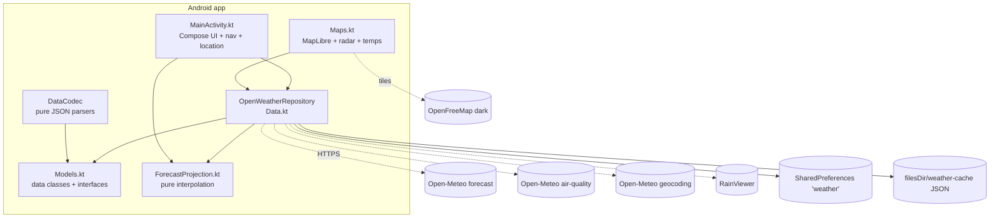
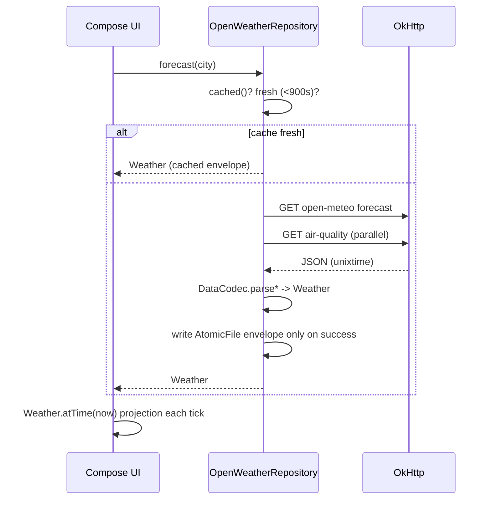
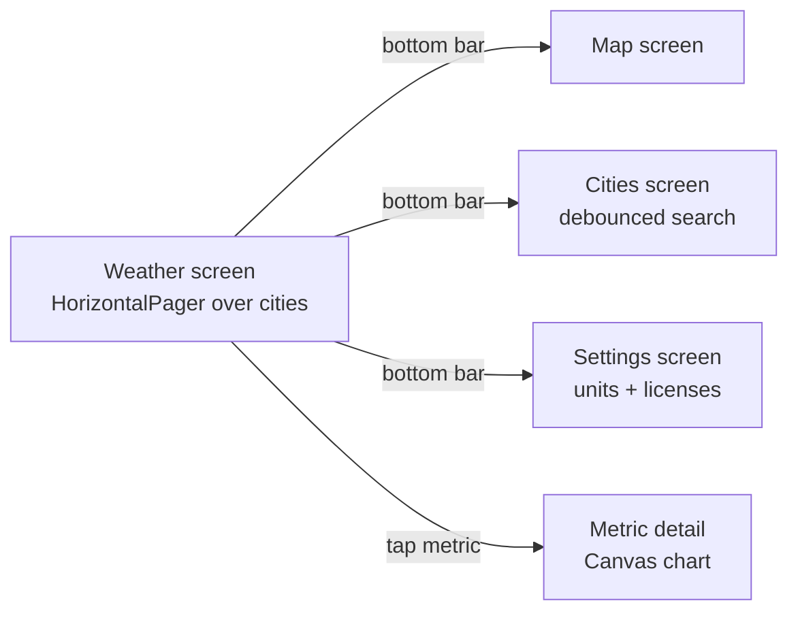
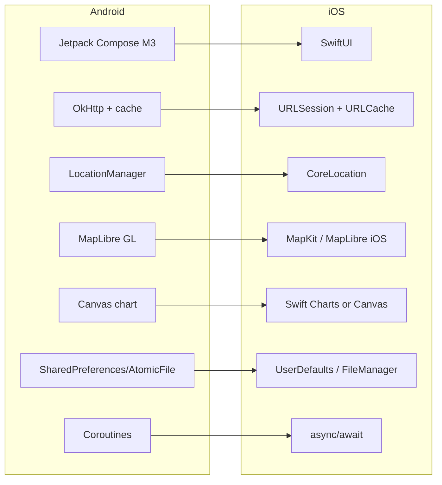

# PORT_GRAPH.md — Android → iOS Port Knowledge Graph

Persistent graph of the Weather app (`Kian-hdr/Weather` @ `6267da88`, v1.1.1). Updated as files are inspected; inspected files are not re-scanned.

## File-dependency table

| File (source) | Role | Depends on | Depends on (external) | iOS counterpart (planned) |
|---|---|---|---|---|
| `AndroidManifest.xml` | App entry, permissions | — | Android SDK | `Info.plist` + entitlements |
| `Models.kt` | Data classes + `WeatherRepository`/`MapRepository` interfaces, formatting helpers, WMO code map | java.time | none | `Models.swift` (structs + protocols, `Date`/`TimeZone`) |
| `Data.kt` (OpenWeatherRepository, DataCodec) | HTTP fetch/parse, caches, prefs | Models, ForecastProjection (no) | OkHttp 4.12, org.json, SharedPreferences, AtomicFile | `OpenWeatherRepository.swift` (URLSession, JSONDecoder, FileManager) |
| `ForecastProjection.kt` | Cached-snapshot projection/interpolation | Models | java.time | `ForecastProjection.swift` (pure logic, direct port) |
| `MainActivity.kt` (516 lines) | All UI + navigation + location + refresh | Models, Data, ForecastProjection | Compose, LocationManager, DataStore-less prefs | `WeatherApp.swift` + `WeatherScreen.swift` + `LocationService.swift` (SwiftUI, CoreLocation) |
| `Maps.kt` (404 lines) | MapLibre map, radar, temperature overlay | Data (MapRepository) | MapLibre GL 13.6.1, OkHttp | `WeatherMap.swift` (SwiftUI + MapKit or MapLibre iOS) |
| `app/build.gradle.kts` | Build config, deps | — | AGP 9.1.1 | `project.pbxproj` / SPM `Package.swift` |
| `app/src/test/*` (3 files, 28 tests) | Unit tests (projection, codec, map geometry) | Models, ForecastProjection | JUnit4 | Swift Testing / XCTest |
| `app/src/androidTest/*` (4 files: OfflineForecastTest, PublicationTest, WeatherArtworkTest, WeatherFlowTest) | Instrumentation tests (device/emulator required — not run in Phase 1) | Models, Data | androidx.test runner | UITests (XCUITest) in Phase 2 |

Verified against the working tree: main sources are exactly 5 .kt files (Data 278 / ForecastProjection 84 / MainActivity 516 / Maps 404 / Models 33 lines) + AndroidManifest.xml; test sources 3 unit + 4 instrumentation files. Working tree byte-identical to commit `6267da88`.

## Build artifact locations (verified)

**Inside the project (Windows):**
- `06_build_artifacts/apk/app-debug.apk` — self-built debug APK
- `00_original/apk/official/Weather_v1.1.1.apk` — official APK (checksummed, never overwritten)
- `01_android_build/logs/`, `01_android_build/reports/` — build log, lint + test reports
- `07_tools/` — portable JDKs, Android SDKs, jadx, apktool

**Outside the project root — WSL ext4 (documented deviations, necessary because the Gradle daemon cannot write registry.bin on /mnt/c drvfs):**
- `/home/naredi/.gradle-weather/` — 1.5 GB total: `caches/` 1.4 GB (dependencies), `wrapper/` 146 MB (Gradle 9.3.1 distribution), `project-cache/` 2.1 MB, `daemon/` 200 KB
- `/home/naredi/.cache/weather/build/` — 285 MB (the repo's own build.gradle.kts redirects build output to `$user.home/.cache/weather/build`): `outputs/` 109 MB (APK), `intermediates/` 173 MB
- Both directories are deletable at any time; they are caches, not source-of-truth artifacts. No other locations outside the project root were written.

Dependency rule observed: `MainActivity → Data → Models`; `ForecastProjection` is leaf-pure (no Android APIs except java.time); `Maps.kt` is the only heavy native dependency. This layering ports cleanly.

## Mermaid: module architecture

## Mermaid: data flow (refresh cycle)

## Mermaid: UI navigation

## Mermaid: Android → iOS portability map

## Portability classification (Step 8 summary)

| Android construct | iOS replacement | Class |
|---|---|---|
| Compose Material3 UI | SwiftUI | Requires rewriting |
| OkHttp (+24MB cache) | URLSession + URLCache | Requires alternative |
| Open-Meteo/RainViewer/OpenFreeMap HTTP APIs | Same APIs, no keys | Directly reusable |
| DataCodec JSON parsers | JSONDecoder / manual | Requires rewriting (logic reusable) |
| ForecastProjection (pure Kotlin) | Pure Swift port | Directly reusable (logic) |
| LocationManager | CoreLocation (CLocationManager) | Requires rewriting |
| MapLibre Android 13.6.1 | MapLibre iOS (same vendor) or MapKit | Requires alternative |
| Canvas weather chart | SwiftUI Canvas / Swift Charts | Requires rewriting |
| SharedPreferences | UserDefaults | Requires alternative |
| AtomicFile JSON cache | FileManager + atomic writes | Requires alternative |
| Coroutines | async/await | Requires rewriting |
| WMO code → text/icon map | same table | Directly reusable |
| `forecast-<bits>.json` cache scheme | same scheme | Directly reusable |

**Bottom line:** no APK-to-iPAs conversion exists; the port is a rewrite of UI and platform glue (~60% of `MainActivity.kt`/`Maps.kt`) while ~40% (Models, DataCodec, ForecastProjection, cache scheme, API contracts) ports near-verbatim as logic.

## Phase 2 additions (2026-11-12) — iOS toolchain verified end-to-end

**Compile-only experiment (G3 skip approved; no auth, no signing, no device):** `05_ios_port/HelloWorld/` (SwiftUI template from `xtool new`, bundle ID `dev.kiankonrad.weather.hello`) compiled and linked against the bundled Darwin SDK **27.2** (`~/.swiftpm/swift-sdks/darwin.artifactbundle`, target `arm64-apple-ios`) with Swift 6.4.2 + xtool 1.24.0 on WSL Ubuntu. Result: unsigned `.app` containing a **Mach-O 64-bit arm64 executable** (magic `cf fa ed fe`, flags `NOUNDEFS|DYLDLINK|TWOLEVEL|PIE`; `llvm-objdump -f`: `file format mach-o arm64`), SHA-256 `25948c8da8fe74e2ca459ce7f24c6fc41f518a00c1db1a170722068d5e4469aa`, 92,648 B. Build time 54 s cold / 18 s warm (ext4 scratch); 0 errors, 33 harmless stale-file warnings. Archived at `06_build_artifacts/hello-world-ios-binary/HelloWorld-App/`. Log: `06_build_artifacts/logs/hello-build-ext4-20261112-224627.log`.

**Toolchain mapping (verified):** SwiftPM `Package.swift` (tools 6.0) ↔ `app/build.gradle.kts`; `xtool.yml` `bundleID` ↔ `applicationId`; `Sources/<Name>/*.swift` ↔ `app/src/main/java/...` — the planned port files in the table above map onto this structure unchanged.

**New documented deviations (WSL ext4, outside project):** `~/hello-src/` (throwaway build scratch — drvfs cannot hold executable Mach-O files; xtool's post-build move to /mnt/c fails with EPERM), `~/.swiftpm/swift-sdks/darwin.artifactbundle` (7.0 GB Darwin SDK 27.2, auto-installed by `xtool sdk status`, removable via `xtool sdk remove`), `~/hello-src/xtool/HelloWorld.app` (working app bundle; archive copy kept inside the project).

Full evidence: `05_ios_port/G3_AUDIT.md`, `05_ios_port/G3_PREP.md`, `05_ios_port/G5_COMPILE_TEST.md`.

## Phase 2 additions (2026-11-13) — G4 auth complete + unsigned IPA packaging

**G4:** Apple authentication completed via `xtool auth login` (mode 1: Password — the free-account path; mode 0 API Key requires a paid Developer Program). Run interactively by the user; `xtool auth status` → exit 0. Token stored at `~/.config/xtool/data/XTLAuthToken` (600), contents never read. No provisioning/device registration.

**Unsigned IPA (packaging ≠ installation):** `xtool dev build --ipa` **without** `--sign` (verified from `--help` that `--sign` is a separate opt-in; no Apple Developer Services invoked) from the ext4 scratch mirror produced `HelloWorld.ipa` (96 KB, 16.07 s build): ZIP = `Payload/HelloWorld.app/{HelloWorld, Info.plist}`; Info.plist `CFBundleIdentifier = dev.kiankonrad.weather.hello`, `MinimumOSVersion 17.0`, platform iPhoneOS; executable Mach-O 64-bit arm64 (`cf fa ed fe`, NOUNDEFS|DYLDLINK|TWOLEVEL|PIE); **unsigned** — 0× `LC_CODE_SIGNATURE`, no `_CodeSignature/`, no `embedded.mobileprovision`. SHA-256 `98b123e85425624e3796cdf09d151552973669f0910dc0afe2f76b573191aa51`, archived at `06_build_artifacts/unsigned-ipa/HelloWorld-unsigned.ipa`. This IPA cannot launch on a device until signed (G5: device registration + free-team provisioning profile — separate, pending approval; free-account limits: 7-day expiry, 3 App IDs/7 days, Developer Mode required). Scripts: `07_tools/ipa-{help,build,verify}.sh`; log `06_build_artifacts/logs/hello-ipa-build-20261113-*.log`.
## 2026-11-13 — Native iOS Port Foundation (WeatheriOS) — BUILDS UNSIGNED
- Step 1 audit (27-feature mapping, statuses Required/Optional/Needs further investigation) and Step 2 architecture presented and reviewed in session.
- New project: `05_ios_port/WeatheriOS/` via `xtool new WeatheriOS --skip-setup`; bundle ID set to **dev.kiankonrad.weather** in `xtool.yml` (distinct from HelloWorld's dev.kiankonrad.weather.hello).
- Foundation sources ported from Kotlin (all traced to source, none invented):
  - Models.kt -> Models/Models.swift (City/Hour/Day/Conditions/AirQuality/Weather/RadarFrame/RadarTimeline/TemperaturePoint/TemperatureGrid; WeatherRepository+MapRepository protocols, async replaces suspend, protocols marked Sendable)
  - Models.kt helpers -> Models/Units.swift (display/temp/speed/localTime, exact conversion constants), Models/WeatherCodes.swift (exact WMO table)
  - ForecastProjection.kt -> Repositories/ForecastProjection.swift (verbatim logic: 900 s current window, 1...3600 s interpolation span, circular wind-direction blend, 6..<18 daylight fallback, air freshness 3600 s)
  - Data.kt -> Services/OpenMeteoClient.swift (5 endpoint constants, exact hourly/daily param lists, User-Agent "Weather/1.1.1 (https://github.com/Kian-hdr/Weather; dev.kiankonrad.weather)", URLCache 24 MB disk mirroring OkHttp cache; RepositoryError enum) + Repositories/OpenWeatherRepository.swift skeleton (UserDefaults suite "weather", Double.bitPattern cache key, cities JSON storage; fetch methods throw .notImplemented for next milestone)
  - MainActivity.kt -> App/WeatherApp.swift (@main, AppEnvironment DI mirroring WeatherApp(repositoryOverride, displayTimeOverride) test seam) + ViewModels/WeatherViewModel.swift (@MainActor @Observable, Screen enum weather/map/cities/settings) + ContentView.swift (WeatherRootView scaffold: weather screen + 3 placeholders)
- Template overwrites (documented per rule 7, files retained per rule 3): WeatheriOSApp.swift (template @main removed — duplicate @main would not compile), ContentView.swift (template 'Hello, world!' replaced).
- Build fixes (Swift 6 strict concurrency, toolchain 6.4.2): OpenMeteoClient marked Sendable; WeatherViewModel marked @MainActor; repository protocols marked Sendable; OpenWeatherRepository @unchecked Sendable with NSLock guarding the in-memory cache.
- Build: mirror to ext4 ~/weather-ios-src, `xtool dev build` (NO --sign, NO --ipa) -> **exit 0**. Output: WeatheriOS.app/WeatheriOS, Mach-O 64-bit arm64 (NOUNDEFS|DYLDLINK|TWOLEVEL|PIE), **LC_CODE_SIGNATURE count 0**, no _CodeSignature/, no embedded.mobileprovision. Info.plist: CFBundleIdentifier dev.kiankonrad.weather, CFBundleExecutable WeatheriOS, MinimumOSVersion 17.0. SHA-256 of executable: 4f80335c5e6c9e7258c1e5febdf5392de7d4a06dc1d29f2661d460d65359dd7c.
- No Apple Developer Services, no authentication, no device operations performed.
- Immutability verified: 0 files under 00_original and 0 under 05_ios_port/HelloWorld modified today.
- Known limitation: `xtool dev` has no test subcommand on Linux — unit tests cannot run for the iOS target in this environment (Android repo has 7 test files: DataTest, ForecastProjectionTest, MapGeometryTest, WeatherArtworkTest, WeatherFlowTest, OfflineForecastTest, PublicationTest); pure-logic ports are structured for future XCTest run on macOS.
- Artifacts copied (cp -n, no overwrite): 06_build_artifacts/unsigned-binaries/WeatheriOS-foundation-20261113.bin and 05_ios_port/WeatheriOS/build-output/WeatheriOS.app; logs in 06_build_artifacts/logs/port-foundation-*.log.
- STOPPED per execution discipline: awaiting user approval before full feature implementation.

## Phase 2 completion (2026-11-13) — workstreams A–G + final unsigned Weather IPA
- Full port finished: `05_ios_port/WeatheriOS/` implements all Kotlin behavior
  (data provider, main screen, cities, metric details, settings/persistence,
  map & radar). Map renderer substitution remains the one documented deviation:
  MapLibre Native + OpenFreeMap vector style → custom SwiftUI Web-Mercator tile
  renderer + CARTO dark-matter raster tiles.
- Parity fixes applied to `WeatherMapView.swift`: Maps.kt:105 basemap-failure
  message and Maps.kt:104 accessibility label (see CHANGELOG).
- Final artifact: `06_build_artifacts/weather-ios-unsigned/Weather-unsigned-20261113-115901.ipa`
  — `Payload/WeatheriOS.app`, bundle id `dev.kiankonrad.weather`, version
  1.1.1 (set post-build via plistlib; xtool 1.24.0 has no plist override),
  Mach-O arm64, unsigned (no LC_CODE_SIGNATURE / _CodeSignature /
  mobileprovision). SHA-256
  `6a032f8aa5cd005a1f57fbd699ec2e41a77122645a59a867363d8f70a5a1231e`.
- Verification: build exit 0, 41/0 logic tests, static bundle inspection —
  no runtime/device verification (restricted). Reproduce: REPRODUCE.md §5–§6.

## 2026-11-13 — Stability-fix graph updates
- NEW `Models/TileCachePolicy.swift` (Foundation-only, shared verbatim with
  WeatherLogicTests) ← used by `Views/WeatherMapView.swift` TileLayer:
  maxTiles=96, maxTotalTiles=256, maxConcurrentTileFetches=8,
  failureRetryDelay=30 s; LRU eviction excluding viewport keys; duplicate
  in-flight/cached fetch suppression.
- NEW `Services/Diagnostics.swift` (`Diag.event`) ← used by ContentView
  (navigation taps), WeatherMapView (tile fetches/failures/evictions, map
  visibility), WeatherViewModel (forecast refreshes, location updates).
  DEBUG-only os.Logger; never logs coordinates/city names.
- `Views/WeatherMapView.swift` TileLayer: identity no longer reset per fetch
  (removed `.id(cacheTick)`); PNG decode via `Task.detached(priority:
  .utility)`; per-namespace cache keys (`cacheNamespace: frame.path` for
  radar frames); bounded @State dictionaries with LRU eviction.
- `ContentView.swift`: metric detail (MetricScreenView) now the last ZStack
  child (was `.background(detailGate)`); HorizontalPager/TabView(.page) →
  iOS 17 paging ScrollView + scrollTargetBehavior(.paging); bottom bar order
  matches Kotlin MainActivity.kt:155-161 (map | dots | settings | cities).
- `Views/ForecastPageView.swift`: metricTiles GeometryReader + fixedSize
  replaced with PreferenceKey width measurement (MetricGridWidthKey).
- `Views/SkyView.swift`: TimelineView throttled to 30 fps, paused under
  Reduce Motion.

## 2026-11-13 — Runtime-debugging diagnostic build (evidence collection)
No behavioral fixes in this round — instrumentation only (temporary, removed
after device issues are resolved):
- NEW `Services/DiagLog.swift` ← ring buffer (600 events, oldest-drop counted)
  used by `Services/Diagnostics.swift`; phys_footprint via task_vm_info
  (Darwin-gated); internal init for logic tests.
- `Views/DiagnosticsScreenView.swift` (new): presets A–E, radar/map-preview
  toggles (`DebugConfig`, persisted), live log view, Copy / Share / Clear.
  Reached via new ⓘ button in ContentView bottom bar (fullScreenCover).
- `App/WeatherApp.swift`: scenePhase transitions + MEMORY WARNING events with
  footprint (jetsam precursor).
- `Views/ForecastPageView.swift`: page lifecycle, content render counts,
  scroll drag detection (simultaneous DragGesture ≥25pt).
- `Views/WeatherMapView.swift`: radar gated on `DebugConfig.radarEnabled`
  (TileLayers + coverage; basemap/gestures/temperature layer intact); events
  for timeline load/failure, animation frames, drags, layer/play taps.
- `ContentView.swift` → `ForecastPageHost` passes `showMapPreview:
  DebugConfig.mapPreviews` (last constructor argument).

## Fix mission 2026-11-13 (crash/navigation/scroll FIXED IPA)

New iOS-side files (no Android counterpart — host-side support/self-test):
- `Models/StabilityPolicies.swift`: Foundation-only helpers (`PagerIndexPolicy.clamp`,
  `RangeSpan.band` geometry) — unit-tested on Linux host.
- `Services/DiagLog.swift`: disk-backed crash-evidence channel (per-session
  `session-<unixtime>[-n].log` files, clean-end marker, synchronous writes so the
  pre-termination trail survives jetsam; privacy-scrubbed).
- `Views/DiagnosticsScreenView.swift`: in-app diagnostics + "Nav self-test" and
  "Scroll self-test" entry points.
- `Views/NavTestView.swift`: minimal SwiftUI navigation proof screen (3 real
  buttons → 3 real destinations) — verifies navigation independently of weather data.
- `Views/ForecastIsolationView.swift`: isolated forecast scroll screen (3-page
  paging ScrollView + 60-row vertical pages, same scroll-target stack as the app).

Modified (fixes documented in `06_build_artifacts/fix-mission-20261113-140433/CRASH-ANALYSIS.md`):
- `Views/ForecastPageView.swift`: single pager identity, simultaneousGesture
  removed, cancel-correct retry loops, guard-let snapshot taps, enumerated-offset
  hour ids, RangeBar guard-unwrapped `RangeSpan.band`.
- `Views/NavTestView.swift` `if let route` renamed binding (Linux swift-frontend
  6.4.2 type-checker assertion workaround).
- `ContentView.swift` / `ViewModels/WeatherViewModel.swift`: clamped `pagerMoved`,
  structured `async let` air-quality fetch.

## REA deep-analysis additions 2026-11-13 (evidence graph for `07_tools/rea-analysis/`)
- Inputs: `00_original/apk/official/Weather_v1.1.1.apk` → REA (portable Node 24 + rea-agents
  6.9.0 + jadx-headless-mcp 0.7.1 + apktool 2.12.1) → out-*.json / decompiled-*.java evidence
  bundles; cross-checked against `00_original/source/Weather`.
- New analysis nodes: ORIGINAL_APK_DEEP_ANALYSIS.md (areas A–E), ANDROID_IOS_PARITY.md
  (Android method ↔ iOS file mapping + parity table), MEMORY_AND_UI_FINDINGS.md.
- No port-graph edges changed; no iOS or Android sources modified. The parity report adds
  recommended (future) edges: ContentView pager identity → city id; bottom-bar →
  safeAreaInset sibling; tile cache → disk-backed.

## Parity mission 2026-11-13 (ANDROID_IOS_PARITY.md implemented)
Android ground truth (MainActivity.kt, Maps.kt) now actually drives the iOS edges:
- ContentView pager: pages keyed by city id via ForEach(cities, id: \.id) +
  scrollPosition(id:) — parity edge to MainActivity.kt:144 HorizontalPager
  key={cities[it].id}. New pure policy PagerPagePolicy (StabilityPolicies.swift)
  converts id<->index in both directions.
- WeatherViewModel: pagerMoved(to:) is the single writer of currentIndex — parity
  edge to MainActivity.kt:104 LaunchedEffect(pager.currentPage); add/remove route
  programmatic page changes through it (Android scrollToPage feedback).
- ContentView bottom bar: moved from overlay to .safeAreaInset(edge: .bottom)
  sibling of the pager — parity to Android Row-after-pager layout hierarchy.
- NEW Models/DiskTileCache.swift (actor): persistent 48 MiB LRU disk tile cache
  with in-flight fetch dedupe, .atomic writes, self-healing index — parity edge to
  Maps.kt:81 cacheDir/map-http HTTP cache. Pure eviction policy in
  TileCachePolicy.evictDisk (host-tested).
- WeatherMapView.mapTileData routes ALL tiles (basemap, radar, temperature) through
  DiskTileCache; radar/temperature rendering code untouched.
- Forecast page hierarchy verified already at parity (one vertical ScrollView per
  city page + horizontal hourly strip): no code change.
Tests: 80/80 (52 XCTest + 28 Swift Testing, incl. 13 new parity tests). IPA:
Weather-unsigned-20261113-150013.ipa (unsigned, arm64) in
06_build_artifacts/weather-ios-unsigned/; baseline preserved in
06_build_artifacts/parity-baseline-20261113/.

## Agent skill — ios-engineering (2026-11-14)

Permanent, reusable, general-purpose iOS Engineering & Reverse Engineering skill
for AI agent sessions, installed at the ZCode workspace-scope skill location:

- `.zcode/skills/ios-engineering/` — auto-discovered by any agent session opened
  inside this repository (`SKILL.md` + README, WORKFLOWS, TOOLS, SAFETY,
  TROUBLESHOOTING, PROJECT_MEMORY_TEMPLATE, `case-studies/`).
- General-purpose by design: no WeatheriOS-specific content in the skill
  instructions; the WeatheriOS tile-task-group watchdog investigation is
  preserved as the case study `case-studies/2026-11-13-tile-taskgroup-prime-loop-watchdog.md`.
- Operating rule encoded in the skill: read-only default; explicit user approval
  before source/test/build-config changes, artifact creation, installs, device
  interaction, or VCS operations.
- Project memory: this graph + PROJECT_STATUS.md + CHANGELOG.md + REPRODUCE.md
  remain the project knowledge base; the skill's PROJECT_MEMORY_TEMPLATE.md is
  for new projects without equivalent documents.
- Not under git version control (as of 2026-11-14); the skill creation added
  files only under `.zcode/skills/ios-engineering/` plus this section.
